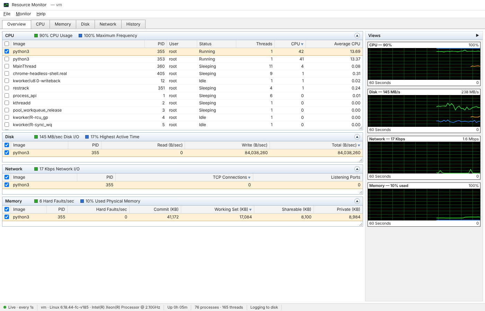

# restrack

Simple, real-time machine resource tracking in Python on top of **psutil** — plus a
browser clone of **Windows Resource Monitor** (resmon), a long-term **metrics log**
with history graphs, threshold **alerts**, a **TOML config file**, and a **profiler for
your own (pandas) code**: time, memory, disk vs OS-cache reads, CPU cache misses, your
cache hit rates and safe-precision dtype suggestions.

Only dependency: `psutil` (pandas optional). The web UI is stdlib `http.server` + vanilla JS (no build step, no CDN).

📖 **Documentation: <https://mrjorgeparr.github.io/restrack/>**



## Install

```bash
pip install restrack
pip install "restrack[gpu]"     # + NVIDIA GPU metrics (nvidia-ml-py)
pip install "restrack[pandas]"  # + pandas, for `restrack dtypes` / DataFrame reports
```

Python ≥ 3.9. Runtime dependency: `psutil` (plus `tomli` on Python < 3.11).

## 30-second tour

```bash
restrack config init        # writes a commented config to ~/.config/restrack/config.toml
restrack web --open         # Resource Monitor UI on http://localhost:8765 (+ logging & alerts)
restrack run                # same logging & alerts, headless (for a service / login item)
restrack history 24h        # summarise the stored log in the terminal
restrack history 7d --csv week.csv
restrack top                # live terminal view
restrack snapshot --json    # one reading as JSON
restrack record -o usage.csv -i 0.5 -d 60   # quick ad-hoc recording (CSV or .jsonl)
restrack profile --open my_job.py --arg 1   # profile a script -> HTML report (options before the script)
restrack dtypes data.csv                    # memory per column + smaller dtypes that keep values exact
restrack counters                           # can this machine read CPU cache counters?
```

`python -m restrack …` works too.

## Metrics collected

| Area | Metrics |
|---|---|
| CPU | total & per-core %, user/system/idle/iowait… breakdown, frequency (and % of max), load average, context switches/s, interrupts/s, syscalls/s |
| Memory | total/used/available/free/cached/buffers, %, swap used/% and swap in/out B/s, hard (major) page faults/s |
| Disk | per physical disk read/write B/s, IOPS, active time %; partitions with free space |
| Network | per adapter send/receive B/s, packets/s, errors, drops, link speed, utilization %; TCP connections & listening ports with owning process |
| Processes | CPU % (of whole machine) + 60 s average, threads, handles/FDs, working set, commit, shareable, private, hard faults/s, disk read/write B/s, sockets, user, status |
| Sensors | temperatures, fans, battery (where the OS exposes them) |
| GPU | NVIDIA utilization, memory, temperature, power (optional extra) |

Rates are computed from counter deltas, so every sample is "per second since the previous sample".

## Python API

```python
import restrack

s = restrack.snapshot()                       # one reading (rates over 0.5 s)
print(s["cpu"]["percent"], s["memory"]["percent"])

for s in restrack.watch(interval=1, count=10):  # simple loop
    print(s["network"]["recv_bps"])

with restrack.Monitor(interval=0.5) as mon:     # background thread + in-memory history
    ...
    mon.latest                                # newest full snapshot
    mon.series("cpu.per_cpu.0")               # [(ts, value), ...]
    mon.subscribe(lambda s: print(s["cpu"]["percent"]))

# config-driven: monitor + SQLite log + alerts + log file
with restrack.Tracker(restrack.load_config("restrack.toml")) as t:
    ...

# query the long-term log yourself
st = restrack.Store("~/.local/share/restrack/metrics.db")
st.query(start_ts, end_ts, points=200)       # downsampled avg + peak per bucket
st.top_processes_at(ts)                       # who was busy at that moment
```

The web server can also be embedded: `restrack.web.ResmonServer(monitor=mon, port=0).start()`.

## The web UI

* **Overview / CPU / Memory / Disk / Network** tabs laid out like resmon, with the
  black 60-second graphs on the right (green = usage, blue = frequency / active time /
  utilization, **orange = the processes you checked**).
* Tick a process checkbox to filter the other tables to it (and see its open files and
  sockets under *CPU → Associated Handles*). Click headers to sort; collapse sections;
  drag the corner of a table to resize it.
* Right-click a process → End / Suspend / Resume / Properties. Control actions are **off**
  unless you start with `--allow-control` (or `allow_control = true`).
* **History** tab: the stored log from 15 minutes to 30 days. Drag across any chart to
  zoom, hover for values (synced crosshair), click a moment to list the busiest
  processes then; alerts show as markers and in the *Events & Alerts* table; export the
  range as CSV.
* *Monitor → Stop Monitoring* freezes the view; *File → Save live snapshot* downloads JSON.

## Storage, logs and alerts

Default locations (override in the config):

| | Linux / macOS | Windows |
|---|---|---|
| config | `~/.config/restrack/config.toml` (or `./restrack.toml`, or `$RESTRACK_CONFIG`) | `%APPDATA%\restrack\config.toml` |
| metrics log (SQLite) | `~/.local/share/restrack/metrics.db` | `%LOCALAPPDATA%\restrack\metrics.db` |
| text log (rotating) | `~/.local/share/restrack/restrack.log` | `%LOCALAPPDATA%\restrack\restrack.log` |

Sizing: with the defaults (one row every 5 s, top 10 processes per row) expect roughly
**12–15 MB per day** (≈ 400 MB at the 30-day default retention); old rows are pruned after `retention_days`. Raise `storage.every`
or lower `top_processes` to shrink it.

Alerts fire when a condition holds for `sustain` seconds, then stay quiet for `cooldown`
seconds; each one is written to the text log as `WARNING ALERT …` and to the events table
(shown in the History tab). Rules: total CPU, memory, swap, disk active time, low free
space on any partition, temperature, and (optionally) any single process' CPU.

See [`restrack.example.toml`](https://github.com/mrjorgeparr/restrack/blob/main/restrack.example.toml) for every option.

## Profile your own code

```python
import restrack

with restrack.Profiler("etl") as prof:
    prof.watch_cache(fx_rate)                 # a functools.lru_cache: hit rate in the report
    with prof.section("load"):
        df = pd.read_csv("big.csv")
    with prof.section("transform"):
        df = transform(df)
        restrack.count("lookup.hit")          # your own cache counters -> hit rate
    prof.inspect(df, "result")                # memory per column + safe dtypes
prof.save_html("etl.html")
```

Per section: wall/CPU time and cores used, peak and kept memory, **disk reads vs OS
page-cache reads**, page faults (RAM vs disk), **CPU cache misses and IPC**, rows/s and
plain-language observations; for the run: a timeline, the **hot lines of your code** and
the pandas call each one spends its time in, cache/counter hit rates and DataFrame
reports. `memory=True` / `where=True` add exact allocation peaks and the lines holding
the memory (slower; use on a data sample). Annotations (`@restrack.track`,
`restrack.section`) can stay in your code: they're no-ops when nothing is profiling.

## Data & numeric precision

`restrack dtypes file.csv` / `restrack.dataframes.memory_report(df)` show what each column
costs and suggest smaller dtypes — `float64 → float32` **only when the values survive the
round trip at the decimals they actually carry** (prices with cents: yes; 123456789.12 or
model scores: no), smallest integer types, nullable integers, `category`, numbers/dates
stored as text. `optimize(df)` applies the safe ones; `--write out.parquet` saves them.

## Limitations

* **CPU cache counters (L1/L2/LLC hits & misses, IPC) are Linux-only.** They're read
  through Linux `perf_event`; **Windows and macOS don't expose them to normal programs**,
  so on those systems the profiler simply leaves these columns out (everything else
  works). Use Intel VTune / AMD uProf (Windows) or Instruments (macOS) if you need them
  there. On Linux they also need the CPU's counters to be visible — true on most
  physical machines, false on many cloud VMs — and `kernel.perf_event_paranoid ≤ 2`.
  Check any machine with `restrack counters`.
* **Disk vs OS-cache read split** (per process and machine-wide) is Linux-only: on Windows
  and macOS psutil can't tell cached reads from disk reads.

## Platform notes

* Per-process network **bytes/s** aren't available from psutil, so the Network tab
  shows socket counts per process; adapter-level bytes are exact.
* macOS needs `sudo` for the connection table and some per-process fields; per-process
  disk I/O isn't available there.
* Temperatures/fans are Linux/FreeBSD only in psutil; battery works on most laptops.
* The UI binds to `127.0.0.1` and rejects foreign `Host` headers (DNS-rebinding guard).
  It exposes process names, users, command lines and connections — think twice before
  `--host 0.0.0.0`.

## Documentation

Full docs: <https://mrjorgeparr.github.io/restrack/> —
[Getting started](https://mrjorgeparr.github.io/restrack/getting-started/) ·
[Command line](https://mrjorgeparr.github.io/restrack/cli/) ·
[Python API](https://mrjorgeparr.github.io/restrack/python-api/) ·
[Web UI](https://mrjorgeparr.github.io/restrack/web-ui/) ·
[Configuration](https://mrjorgeparr.github.io/restrack/configuration/) ·
[Storage & alerts](https://mrjorgeparr.github.io/restrack/storage-and-alerts/) ·
[Profiling your code](https://mrjorgeparr.github.io/restrack/profiling/) ·
[Data & precision](https://mrjorgeparr.github.io/restrack/dataframes/) ·
[Metrics reference](https://mrjorgeparr.github.io/restrack/metrics/) ·
[HTTP API](https://mrjorgeparr.github.io/restrack/http-api/) ·
[Platform notes](https://mrjorgeparr.github.io/restrack/platform-notes/) ·
[Development & releasing](https://mrjorgeparr.github.io/restrack/development/)

## Tests

```bash
pip install -e ".[test]" && pytest      # 38 tests
```

## License

MIT
