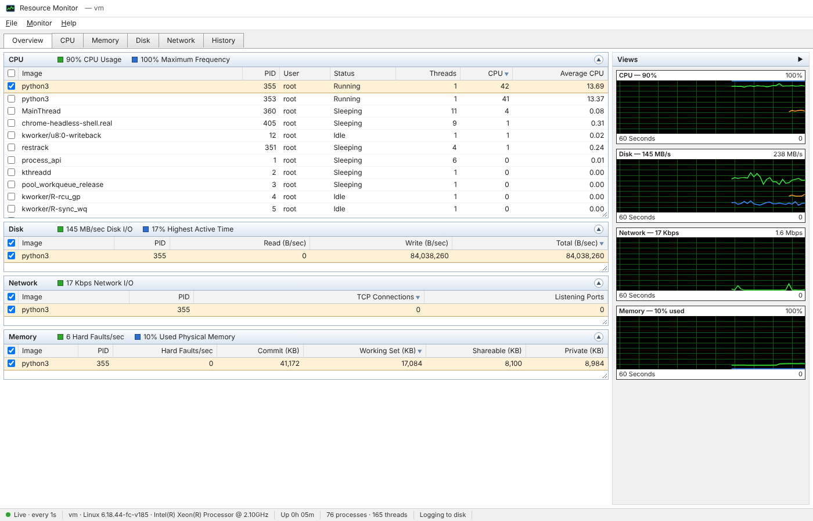

# restrack

Simple, real-time machine resource tracking in Python on top of
[psutil](https://github.com/giampaolo/psutil), with:

- a **Python API** for one-off readings, live streams and background monitoring;
- a **browser clone of Windows Resource Monitor** (resmon) that runs on any OS;
- a long-term **metrics log** (SQLite) with zoomable **history graphs**;
- threshold **alerts** written to a rotating log file;
- one **TOML config file** for all of it;
- a **profiler for your own code**: time, memory, disk vs OS-cache reads, CPU cache misses,
  your cache hit rates and hot lines, as an HTML report;
- **numeric precision checks** for pandas: smaller dtypes only where values stay exact.

The only dependency is `psutil` (plus `tomli` on Python < 3.11; pandas is optional). The web UI uses the standard-library HTTP server and
plain JavaScript, with no build step and nothing loaded from a CDN.



## Quick start

```bash
pip install restrack
restrack config init      # optional: write a commented config file
restrack web --open       # UI on http://localhost:8765, plus logging and alerts
```

```python
import restrack

s = restrack.snapshot()
print(f"CPU {s['cpu']['percent']}%  RAM {s['memory']['percent']}%")
```

## Where to go next

| If you want to… | Read |
|---|---|
| install it and see it running | [Getting started](getting-started.md) |
| use it from the terminal | [Command line](cli.md) |
| use it from Python | [Python API](python-api.md) |
| learn the UI | [Web UI](web-ui.md) |
| change intervals, paths, thresholds | [Configuration](configuration.md) |
| understand the log, history and alerts | [Storage & alerts](storage-and-alerts.md) |
| know exactly what each field means | [Metrics reference](metrics.md) |
| query the server from scripts | [HTTP API](http-api.md) |
| profile a script or notebook | [Profiling your code](profiling.md) |
| shrink DataFrames without losing precision | [Data & precision](dataframes.md) |
| know what differs per OS | [Platform notes](platform-notes.md) |
| contribute or release | [Development](development.md) |
