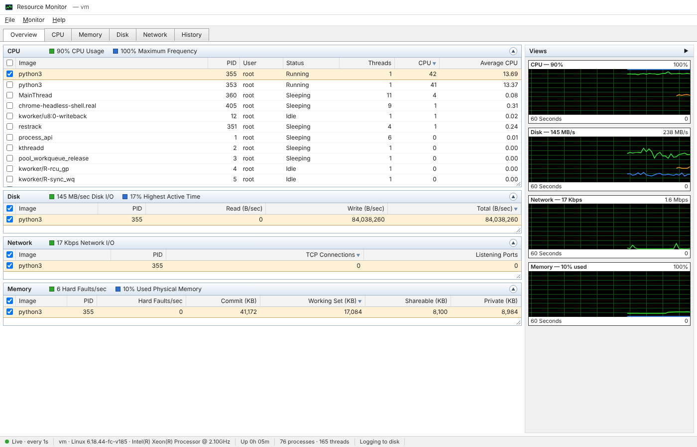
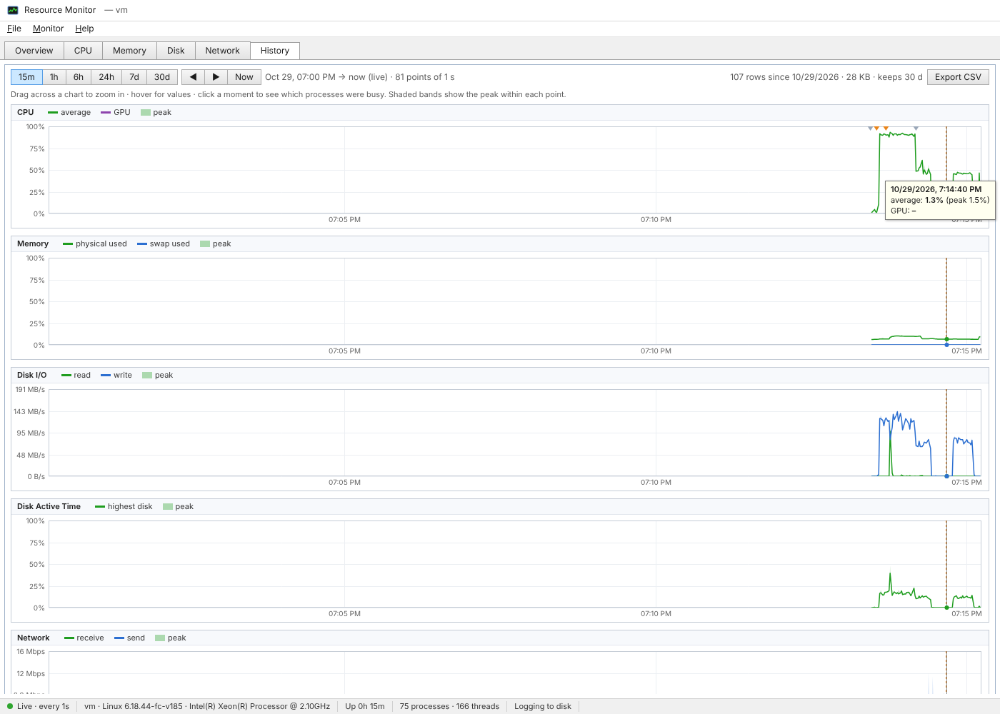

# Web UI

```bash
restrack web --open          # http://localhost:8765
```

The UI follows the layout of Windows Resource Monitor. Tables are on the left and the
**Views** pane on the right holds 60-second graphs that scroll as new samples arrive
(once per sample interval). The `▶` button collapses the Views pane.



## Reading the graphs

The live graphs have a black background and draw up to three lines:

| Colour | Meaning |
|---|---|
| **green** | the main metric: usage, throughput or memory used |
| **blue** | a percentage on its own 0–100 % scale: CPU frequency, disk active time, network utilization, swap |
| **orange** | the processes you've **checked** (CPU and disk graphs) |

The top-right label shows the graph's current scale. Throughput graphs rescale
automatically to the visible window.

## Tabs

| Tab | Left side | Graphs |
|---|---|---|
| **Overview** | CPU, Disk, Network and Memory sections, each with a summary bar; a GPU section appears when NVIDIA metrics are available | CPU, Disk, Network, Memory (+ GPU) |
| **CPU** | Processes (with handles), **Associated Handles** (open files and sockets of checked processes), **Scheduler & Load** (load average, context switches, interrupts, time breakdown…), **Sensors** | total + one per logical core |
| **Memory** | Processes (commit, working set, shareable, private, hard faults/s) and a **Physical Memory** bar: In Use / Standby & Cache / Free | used %, swap %, hard faults/s |
| **Disk** | processes with disk activity (incl. **Cache Read** on Linux: reads served without disk I/O), per-disk activity (B/s, IOPS, active time), **Storage** (partitions and free space); the header shows the % of reads served from cache | total + active time per disk |
| **Network** | processes with sockets, per-adapter activity, **TCP Connections**, **Listening Ports** | total, per adapter, TCP connection count |
| **History** | the long-term log, covered [below](#history-tab) | — |

### Process columns

| Column | Meaning |
|---|---|
| CPU | % of the **whole machine** over the last sample (100 % = every core busy), as in resmon |
| Average CPU | exponential average over about 60 s |
| Commit (KB) | virtual memory size (`vms`) |
| Working Set (KB) | resident memory (`rss`) |
| Shareable / Private (KB) | shared pages, and resident minus shared (on Windows, private bytes) |
| Hard Faults/sec | Linux: major page faults; Windows: all page faults |
| Read / Write (B/sec) | process disk I/O |
| Handles | open handles (Windows) or file descriptors (Linux, macOS) |
| TCP Connections / Listening Ports | sockets owned by the process |

## Interacting

- **Check a process** (checkbox) to filter the Disk, Network and Memory tables to it,
  move it to the top of the tables, draw its usage in orange, and list its open files
  and sockets under *CPU → Associated Handles*. The header checkbox selects every
  visible row.
- **Sort** by clicking a column header; click again to reverse.
- **Collapse** a section by clicking its header bar.
- **Resize** a table by dragging its bottom-right corner.
- **Right-click** a process for *End Process*, *End Process (Force)*, *Suspend*,
  *Resume*, *Check* and *Properties…*. **Double-click** a row also opens Properties,
  which shows the command line, executable, working directory, open files, sockets,
  unique memory and context switches.
- The **Monitor** menu's *Stop Monitoring* freezes the view while the server keeps
  sampling and logging. *Start Monitoring* resumes it.
- **File → Save live snapshot** downloads the current snapshot as JSON.

Sort order, collapsed sections, the active tab and the Views pane state are remembered
in your browser.

### Process control is off by default

*End / Suspend / Resume* are greyed out unless the server was started with
`--allow-control` (or `allow_control = true` in `[web]`). Even then:

- each action asks for confirmation;
- PID 0, PID 1 and the restrack process itself are refused;
- actions need the same OS privileges as doing it yourself, so ending another user's
  process needs an elevated prompt or sudo.

## History tab



The History tab reads the long-term metrics log, so it needs
[storage enabled](configuration.md#storage-long-term-metrics-log) (on by default).
It shows six charts on one shared time axis:

| Chart | Lines | Shaded band |
|---|---|---|
| CPU | average CPU, GPU (if any) | CPU peak |
| Memory | physical used %, swap used % | memory peak |
| Disk I/O | read and write B/s | read and write peaks |
| Disk Active Time & Cache Hits | busiest disk %, % of reads served from cache (Linux) | disk active peak |
| Network | receive and send | their peaks |
| Load & Temperature | 1-minute load average, hottest sensor °C | temperature peak |

Each point is a time bucket. The line is the bucket's average and the **shaded band
reaches up to its maximum**, so short spikes stay visible even when zoomed out to 30 days.
Gaps in the lines are periods when restrack wasn't running.

- **Range buttons** `15m 1h 6h 24h 7d 30d`, with **◀ ▶** to page through time and
  **Now** to return to a live view. A live view refreshes every 15 s.
- **Drag** across any chart to zoom into that span.
- **Hover** to see exact values; the crosshair is shared by all charts.
- **Click** a moment to fill *Top Processes at Selected Time* with the busiest
  processes around it (average and peak CPU, memory, disk I/O). This answers questions
  like "what was hammering the machine at 03:12?".
- Alerts appear as orange markers along the top of the CPU chart and are listed in
  *Events & Alerts*, along with start and stop events.
- **Export CSV** downloads the raw rows for the visible range.

## Status bar

From left to right: connection state (live, monitoring stopped, or disconnected and
retrying), host and OS, uptime, process and thread counts, and whether data is being
logged to disk. The browser reconnects automatically if the server restarts.
